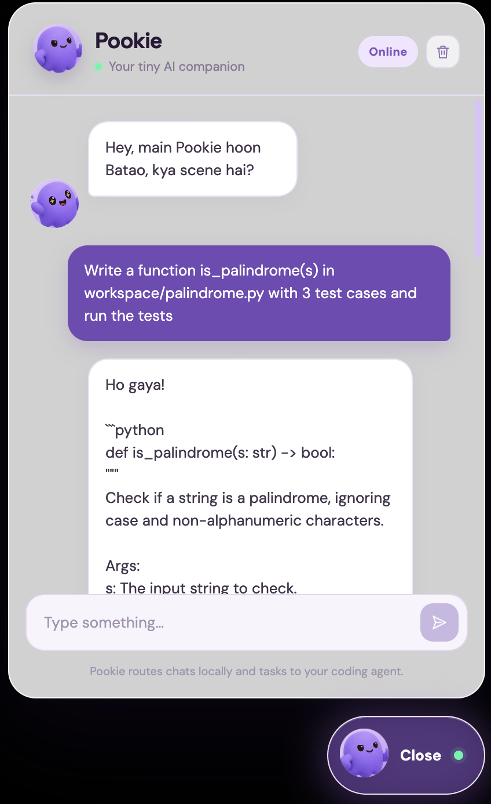
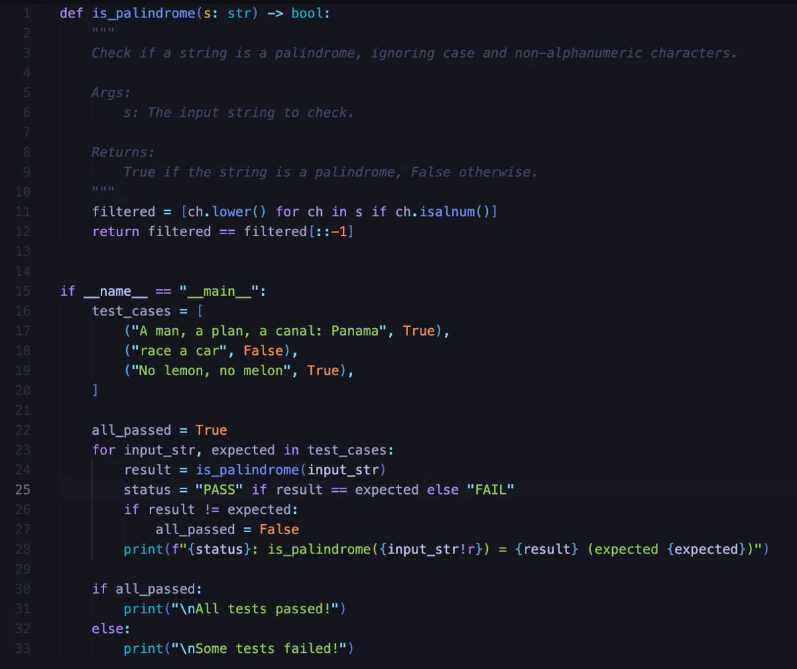
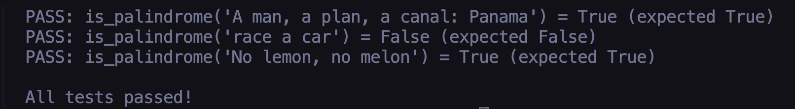
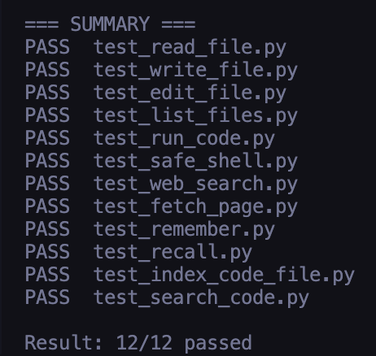

# agent-toolkit

Local AI coding agent with 12 tools (files, code, web, memory, code search) and a desktop companion named Pookie.

## Features

| Tool | What it does |
| --- | --- |
| `read_file` | Reads a UTF-8 file inside `workspace/`. |
| `write_file` | Creates or overwrites a file inside `workspace/`. |
| `edit_file` | Replaces one exact occurrence in a workspace file. |
| `list_files` | Lists files recursively in a workspace directory. |
| `run_code` | Runs Python source code in a subprocess or restricted sandbox. |
| `safe_shell` | Runs an allowlisted command without a shell. |
| `web_search` | Searches the web with DuckDuckGo. |
| `fetch_page` | Fetches visible page text with Playwright. |
| `remember` | Stores a note in ChromaDB memory. |
| `recall` | Retrieves related notes from ChromaDB. |
| `index_code_file` | Parses and indexes Python functions and classes. |
| `search_code` | Searches indexed code chunks. |

## Setup

```bash
conda activate agent
pip install -r requirements.txt
playwright install chromium
```

Create a local `.env` file with the `NVIDIA_API_KEY` setting. Keep it untracked and never commit its value.

## Run

Start the backend in one terminal:

```bash
cd ghost-companion/backend
uvicorn api:app --reload --port 8000
```

Start the desktop companion in another terminal:

```bash
cd ghost-companion/frontend
npm install
npm run electron:dev
```

## Tests

```bash
python workspace/tool_tests/run_all_tests.py
```

Expected result: all 12 tests pass. `fetch_page` needs Chromium and network access; memory tests need the Chroma embedding model.

## Demo





## Test results



> Note: the Pookie chat UI is experimental. The 12 tools are covered by `workspace/tool_tests`.

## Project structure

```text
.
├── agent.py
├── api.py
├── tools.py
├── memory.py
├── run_code.py
├── filesystem.py
├── search.py
├── prompts.py
├── config.py
├── ghost-companion/
├── workspace/tool_tests/
└── docs/
```
